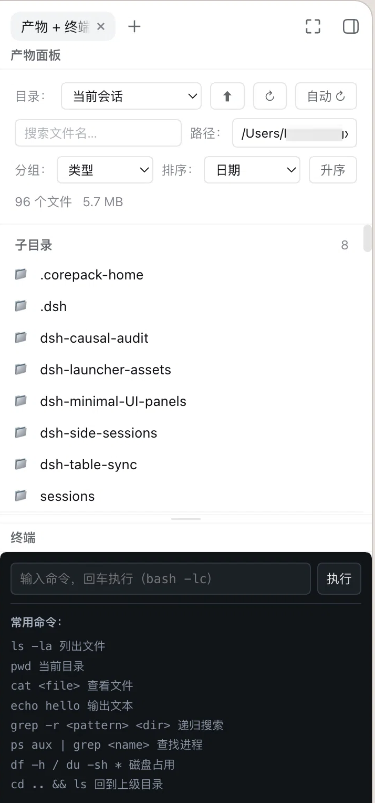
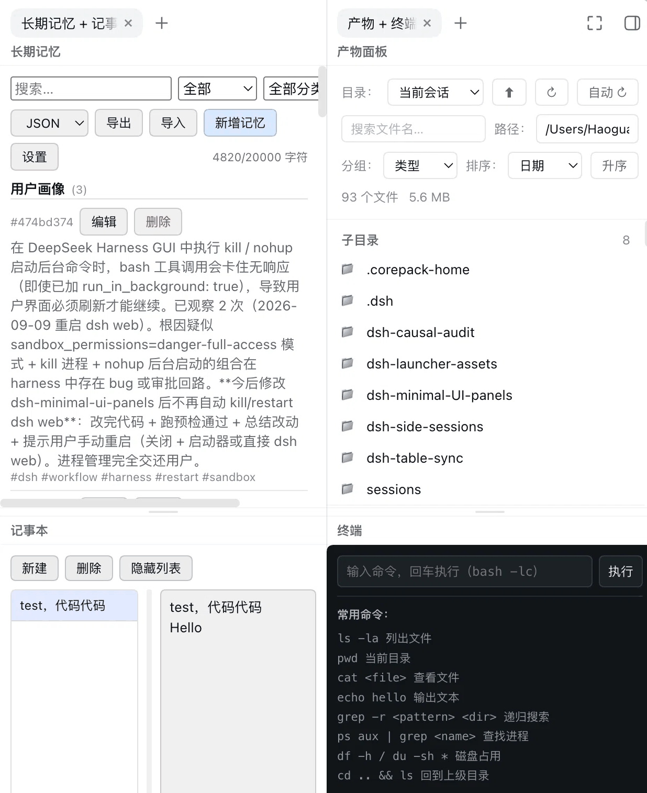

# dsh-minimal-UI-panels

> [English](./README.md) · [中文](./README.zh-CN.md)

<p>
  <a href="https://github.com/windrover/dsh-minimal-UI-panels"></a>
  <a href="https://github.com/windrover/dsh-minimal-UI-panels/blob/main/LICENSE"></a>
  <a href="https://github.com/windrover/dsh-minimal-UI-panels"></a>
  
  
</p>

> All-in-one DeepSeek Harness UI panels — 一个 bundle、一个 loader 行，把产物 / 记忆 / 终端 / 记事本**两两配对**成 2 个右侧栏标签页类型，每个标签内部上下可拖分栏。

`dsh-minimal-UI-panels` 把三个原本独立的 DSH 插件合并为一个包，并以**单 loader 行**挂载。面板**两两配对**注册为 `@deepseek-ai/dsh-client-ui-sidebar-right` 的**标签页类型**（`ctx.sidebarRightTabs`）：`产物 + 终端`、`记忆 + 记事本`，每个标签内部上下叠放、中间可拖动分栏——这样把两个窗格并排就能同时看到 4 个面板。同时提供宿主侧工具/路由，即插即用。

> **DSH 0.1.5 起架构已变**：旧版那个可被第三方占用的 `details` 列已被 `rightbar` 取代，由官方右侧栏（docking kit + 标签类型注册表）接管。本包 0.2.0 完成该迁移——不再有自绘的多面板容器。

## ✨ 功能一览

| 面板 / 能力 | 说明 |
|---|---|
| **成对的右侧栏标签页类型** | 每个类型 = **一对面板**，上下叠放、中间是可拖动的分隔条（比例按类型记住，双击回到 50/50）。停靠 / 浮动 / 分屏由官方 docking kit 提供；**把两个窗格并排，就能同时看到 4 个面板**。入口是标签条的「+」→ guide 页 |
| **产物面板** | 扫描工作区产物文件，按类型/日期/体积/行数分组排序；代码/配置/数据预览语法高亮；图片 base64 预览（4 MiB 上限）；mp4/m4v/webm/ogv 视频流式播放（支持 Range 请求） |
| **记忆面板** | 三作用域（user/global/workspace）记忆的查看、新增、搜索、编辑；标签分组；内容高亮 |
| **终端面板** | 深色终端外观的 bash 命令执行器（`bash -lc`），输出收集后返回，下方常驻常用命令提示 |
| **记事本面板** | Apple 便签风格多条目记事：侧边列表 + 正文编辑、新建/删除、自动保存（600ms 防抖）、按首行自动命名，存储于 `~/.dsh/notes.json` |

## 📸 截图

右侧栏里开着**「产物 + 终端」**这一对：上面是产物面板，下面是终端，中间是可拖动的分隔条。标签条上的胶囊名就是这一对的类型名。



把另一个标签**拖到窗格的左/右边缘**就分出第二个窗格——两个窗格并排，四个面板同时可见：



## 📦 安装

本插件以**本地 link 依赖**挂载（与 DSH 本地插件一致）。

### 1. 克隆仓库

选一个目录并克隆：

```bash
git clone https://github.com/windrover/dsh-minimal-UI-panels.git
# → <你的路径>/dsh-minimal-UI-panels
```

### 2. 在 DSH profile 中登记

编辑 `~/.dsh/profiles/web/package.json`，把 `link:` 改成**你自己的克隆路径**（`<你的路径>` 是你克隆到的目录）：

```jsonc
{
  "dependencies": {
    "dsh-minimal-ui-panels": "link:<你的路径>/dsh-minimal-UI-panels"
  },
  "dsh": {
    "profile": {
      "bundles": [
        "@deepseek-ai/dsh-base",
        "@deepseek-ai/dsh-web-app",
        "dsh-minimal-ui-panels"
      ]
    }
  }
}
```

> 把 `<你的路径>` 换成克隆目录的绝对路径，例如 `link:/Users/me/dev/dsh-minimal-UI-panels`。
> 目录名可以带大写（如 `dsh-minimal-UI-panels`）——**目录名不影响加载**，真正起作用的 identity 是 `package.json` 的 `name`。

### 3. 建立 link

```bash
cd ~/.dsh/profiles/web && pnpm install
```

### 4. 重启 dsh web

**Ctrl+C 退出 → 重新 `dsh web` → 浏览器刷新**。loader 启动时扫描 profile bundles，新代码即生效。

> 若你之前挂载过那几个旧插件，请从 `dsh.profile.bundles` 列表移除它们（本包已取代）；同时清理 `~/.dsh/cordis.patch.yml` 中残留的旧行（如 `- id: artifacts-panel`），避免 `patch: entry ... not found` 告警。

## 🖥 使用

- 打开任意会话 → 右侧栏（对话区右上角的展开按钮）→ 点标签条的「+」打开 **guide 页** → 选择 **产物 + 终端** 或 **长期记忆 + 记事本**。
- **同时看 4 个面板**：把标签**拖到窗格的左/右边缘**分出第二个窗格，两格各开一对即可；每对内部的上下比例用中间的分隔条调，双击回到 50/50。空间不够时把右侧栏宽度拖大。
- **终端**：输入命令回车执行（`bash -lc`），输出展示在下半区，常用命令提示常驻。
- **记事本**：点「新建」创建条目，左侧列表可拖动分隔条调宽，点击标题自动隐藏列表聚焦正文，工具栏可手动显示/隐藏列表。
- **`/memory`** 命令（宿主侧）：`/memory list|search|get|forget|export` 管理长期记忆。
- 宿主侧还提供模型工具：`memory_*`（write/recall/list/forget/export/import/correct/batch/diagnose）与 `artifacts_list`。

### 产物落在哪里

一次对话只占一个目录，凭路径就能定位：

```
<workspace>/sessions/<YYYY-MM-DD>-<标题slug>-<会话id前8位>/
    README.md      索引：这次对话在做什么 + 每个产物是什么
    docs/          md、txt、pdf、docx、pptx
    data/          csv、tsv、xlsx、json、yaml、sqlite
    images/        png、jpg、webp、svg、gif
    scripts/       py、sh、js、mjs、ts、ipynb
    media/         mp4、mov、mp3、wav
    misc/          其他，以及临时文件
```

- **日期是这次对话开始当天的本地日期**（不是每次写入的日期，也不是 UTC），**slug 是会话标题**——目录名既可读，又在整个会话期内稳定。
- **会话 id 前 8 位是稳定键**：本会话已存在的目录一律**复用**，包括旧版本写下的 `<日期>-<完整会话id>`，所以升级后不会分叉、不会散落。
- **子会话嵌套**在父会话目录下：`<父目录>/subagents/<slug>-<id8>/`。
- 目录**不预创建**：第一次真正写入才出现，所以只问不做的会话不会留下空目录。
- 面板**默认打开本会话的产物目录**（由宿主路由 `/api/artifacts/session-dir` 给出）；目录尚未出现时留在工作区根，而你自己选过的目录永远优先。
- `artifacts_list` 不带 `dir` 时扫描**本会话的产物目录**（尚不存在则退回工作区根）。面板只扫你指定的目录、从不解析目录名，因此任何既有结构都照常列出与预览。

宿主要注入的精确路径由 `tool:artifacts-session-dir` 提示段给出；规则本体在 `lib/host/artifact-paths.js`，由 `test/artifacts-naming.test.mjs` 钉住。

## 🏗 架构

```
dsh-minimal-UI-panels  (一个 loader 行 / 一个包)
│
├── lib/index.js  ── 宿主半身【薄组合入口】
│   └── import + 按序调用:
│       ├── lib/host/ltm.js              ← 原 dsh-long-term-memory（一字不改）
│       │     └── store.js / threats.js / llm.js / automation.js
│       ├── lib/host/artifacts.js        ← 原 dsh-artifacts-panel（一字不改）
│       │     └── artifact-paths.js      ← 每会话产物目录布局（命名、复用、子会话嵌套）
│       └── lib/host/terminal-notes.js   ← 原 dsh-terminal-notes（一字不改）
│       inject = tools, systemPrompt, commands, settings, agents,
│                webServer, workspaceRegistry, subprocess, fs
│
├── src/           ── 浏览器半身源码【改面板 UI 就改这里，受版本控制】
│   ├── composite/client.js          ← 组合容器：拥有全部右侧栏注册（2 个 tab 类型 + 可拖分隔条）
│   ├── artifacts/client.js          ← 产物面板（只提供组件，不注册 tab 类型）
│   ├── long-term-memory/client.js   ← 长期记忆面板（同上，另提供设置卡片）
│   └── terminal-notes/client.js     ← 终端 + 记事本两个面板（同上）
│
└── lib/client.js  ── 浏览器半身【合并单 bundle = scripts/merge-client.mjs 生成，勿手改】
    ├── function artifacts(react, react_jsx_runtime, panels)      ← 提取自 src/artifacts/client.js
    ├── function ltm(react, react_jsx_runtime, panels)            ← 提取自 src/long-term-memory/client.js
    ├── function terminalNotes(react, react_jsx_runtime, panels)  ← 提取自 src/terminal-notes/client.js
    ├── function composite(react, react_jsx_runtime, panels)      ← 提取自 src/composite/client.js
    │     三个面板 fn 只往 panels 注册表里写 { Component, ns, titleKey, t }；composite 读它渲染
    └── function apply(ctx)   ← 主入口：const panels = {} → 依次 apply（composite 必须最后）
        exports.inject = ["slots", "locale", "sidebarRightTabs"]

右侧栏标签页类型（**每个类型 = 一对面板**，每个类型再在 sidebar.right.pane.tab 槽下按自己的 id 注册 body）：
    dsh-minimal-ui-panels/artifacts-terminal  kind "artifacts-terminal"   上：产物　下：终端
    dsh-minimal-ui-panels/memory-notes        kind "memory-notes"         上：长期记忆　下：记事本

宿主工具/路由: memory_*(9) + artifacts_list, /api/artifacts/*, /api/terminal-notes/*
```

合并流程（详见 `scripts/merge-client.mjs`）：

```
src/artifacts/client.js        ─┐
src/long-term-memory/client.js ├─ 提取 factory 体 → 改写 react/react_jsx_runtime
src/terminal-notes/client.js   │   绑定、删除子模块内 exports. 语句
src/composite/client.js        ─┘   （必须最后合并：它读前面填好的 panels 注册表）
                                           │
                                           ▼
                            lib/client.js  (单 __ModuleLoader__.load bundle)
```

> 📌 **源码就在本仓库**（`src/<panel>/client.js`）。早期版本从三个**兄弟目录**读取，而那三个仓库后来被 GitHub 归档（只读，push 返回 403），源码没有任何版本控制兜底；当时直接改生成产物 `lib/client.js` 的改动被下一次合并覆盖后**无法从 git 恢复**。现已内联——克隆本仓库即可完整重建浏览器半身。

> ⚠️ **关键约定：三处名字必须逐字节一致**（本包为小写 `dsh-minimal-ui-panels`）
>
> 1. `cordis.patch.yml` 里 `insert.name`
> 2. `lib/client.js` 里 `__ModuleLoader__.load({ id })`
> 3. `package.json` 的 `name`
>
> 机制：`dsh-client-modules` 的 `nearestPackage()` 从 Loader 行解析出的模块路径逐级向上找 `package.json`，**只接受 `name === 该 specifier` 的那一个**；随后 `arrive()` 再断言 `factories.has(row.id)`。任一环大小写不一致，**整个浏览器半身会静默地不进 `window.__DSH_BOOT__`**——而宿主半（工具/路由）照常工作，极易误判成「插件在跑」。
>
> 这正是 0.1.x 遗留的隐藏 bug：`package.json` 早已改成小写，但 `cordis.patch.yml` 与 client bundle 仍写着大写 `UI`。目录名带不带大写无关紧要，**一切以 `package.json` 的 `name` 为准**。

### 为什么不再需要「多面板容器」，以及为什么面板要两两配对

旧版四个插件必须合并，是因为它们都要抢同一个 `details` 单槽。DSH 0.1.5 换成 `rightbar` 之后，每个面板注册**自己的 tab kind 与 body key**，彼此不再竞争——容器这个角色由官方右侧栏接管，本包因此删掉了 `dsh-details-tabs`（约 1100 行）及其自绘的布局持久化 / DockRail。

但「一个面板一个标签」有个现实问题：右侧栏最多分**两个窗格**，所以一屏最多只能同时看到 2 个面板，切换成本高。因此 0.3.0 起把面板**两两配对**——一个标签内部上下叠放两个面板，中间是可拖动的分隔条。于是两个窗格并排 = 4 个面板同时可见；而拖动分隔条把某一半压到 15% 就等同于单面板视图。配对关系写在 `src/composite/client.js` 的 `PAIRS` 数组里，改组只需改那一处。

## 🌐 宿主路由

与各原插件一致，未作变更：

| 方法 | 路径 | 说明 |
|---|---|---|
| POST | `/api/artifacts/scan` | 扫描目录 |
| GET | `/api/artifacts/session-dir` | 本会话的产物目录（`?sessionId=&cwd=`），面板据此默认打开它 |
| GET | `/api/artifacts/read` | 读文件预览 |
| GET | `/api/artifacts/media` | 视频流（支持 Range） |
| POST | `/api/terminal-notes/exec` | 执行 bash 命令 |
| GET/POST | `/api/terminal-notes/notes` | 列出 / 新建记事 |
| GET/POST | `/api/terminal-notes/note` | 读 / 存单条记事 |
| POST | `/api/terminal-notes/note-delete` | 删除记事 |

## 🛠 开发与验证

- 改代码后先跑预检（DSH 插件工作流）：

  ```bash
  bash ~/.dsh/dsh-plugin-precheck.sh web --tests
  ```

  预检会做：宿主插件树加载（`--dump-config`）+ 各插件 `node --check` + 客户端 bundle mock 装载契约断言 + 本仓库单元测试。**通过后才允许重启**；进不去时用 `~/.dsh/dsh-safe-start.sh` 安全启动。

- 本包的契约测试 `test/client-contract.test.mjs` 比预检更进一步：它在桩环境里**真正执行 `apply(ctx)`**，断言 2 个组合 tab 类型（id/kind/priority/guide 条目）、2 个 `sidebar.right.pane.tab` body，并真的把每个 body 渲染一遍——检查两个半边各自的标题、两个面板都以 `embedded: true` 且用**各自的**译者渲染、以及可拖动分隔条存在：

  ```bash
  node test/client-contract.test.mjs
  ```

- `test/artifacts-scroll.test.mjs` 用一个极小的 hook 运行时**真实渲染产物面板**并驱动一次「打开预览 → 返回」的往返，断言列表滚动位置被还原、且还原发生在 **layout effect**（绘制前，不会先闪顶部再跳回）；同时验证换目录会丢弃记忆的偏移。它顺带能抓住「effect 依赖数组里引用了 TDZ 变量」这类 `node --check` 看不到的错误：

  ```bash
  node test/artifacts-scroll.test.mjs
  ```

- `test/artifacts-session-default.test.mjs` 真实渲染面板，钉住它打开时落在哪里：本会话已有产物目录时打开它；尚不存在时退回工作区根（扫不存在的目录会 404，而不是空列表）；宿主还没提供 `/api/artifacts/session-dir` 时同样退回；用户自己钉住的目录永远优先：

  ```bash
  node test/artifacts-session-default.test.mjs
  ```

- `test/artifacts-naming.test.mjs` 钉住「一次对话一个目录」的布局：本地开始日期（并把旧的 UTC 差一天作为反例钉住）、可读且路径安全的 slug、既有目录（含旧版 `<日期>-<完整会话id>`）必须复用、子会话嵌套、提示原文，以及 `artifacts_list` 默认扫描本会话目录且不创建目录：

  ```bash
  node test/artifacts-naming.test.mjs
  ```

- `test/terminal-exec.test.mjs` 是宿主侧测试：给宿主插件一个 mock ctx，抓住 `/api/terminal-notes/exec` 注册的路由并真正调用它，断言 spawn 用的是 `stdin: 'ignore'`（fd 0 指向 /dev/null）、带了 abort signal，且被执行期限终止的命令会返回分类后的 `timeout` 结果**连同它已经打印的输出**：

  ```bash
  node test/terminal-exec.test.mjs
  ```

- 浏览器半身是**生成产物**，源码在 `src/`。改面板 UI 请改 `src/<fragment>/client.js`，然后重新生成：

  ```bash
  node scripts/merge-client.mjs          # 生成 lib/client.js
  node scripts/merge-client.mjs --check  # 只校验是否过期（过期退 1，可挂进 CI/预检）
  ```

  脚本从 `src/{composite,artifacts,long-term-memory,terminal-notes}/client.js` 提取 factory 体、改写 react/`react_jsx_runtime` 绑定、删除子模块内 `exports.` 语句，并把一个共享的 `panels` 注册表作为第 3 个参数传给每个 fragment（三个面板 fragment 往里写组件，`composite` 读它渲染）。**`composite` 必须最后合并**，否则注册表是空的。**直接改 `lib/client.js` 的改动会在下次生成时丢失**——脚本覆盖前会打印「would change +N/-M」警告，`--check` 则完全不写文件。

- 数据位置：长期记忆 `~/.dsh/dsh-memory/{global,user}.jsonl`、工作区 `.dsh/memory.jsonl`；记事本 `~/.dsh/notes.json`。

## 🔒 注意事项

- 记事本存储为单 JSON 文档（fs 服务无 unlink 原语，单文件原子重写更可靠）。
- **终端不是交互式 shell**：它执行 `bash -lc <你输入的那一行>`，子进程的 stdin 是 `/dev/null`（所以 `bash`、`cat`、`read`、`python` 这类**读 stdin** 的命令会立刻拿到 EOF 退出，而不是把面板挂住）。命令运行中会出现**「终止」按钮**（对应宿主路由 `POST /api/terminal-notes/exec-cancel`，用面板为每次执行生成的 `runId` 定位正在跑的子进程）。每条命令另有 **120 秒**执行期限，超时会被终止、并把已打印的输出一并返回；期限可用宿主配置 `terminalNotes.timeoutMs` 调整。**手动终止与超时是两种不同结果**（`cancelled` / `timeout`），两者都会保留已打印的输出。需要交互或长时间的构建，请用会话自带的 bash 工具。
- 面板不再自绘任何栏宽/布局；停靠、浮动、分屏与宽度都由官方 `dsh-client-ui-sidebar-right` 的 docking kit 决定。升级 dsh 不会再冲掉本包的布局改动（因为已经没有这类改动）。
- 本包仅动态注册的服务/路由/工具随 fiber 生命周期；停止或热更新会移除全部副作用。
